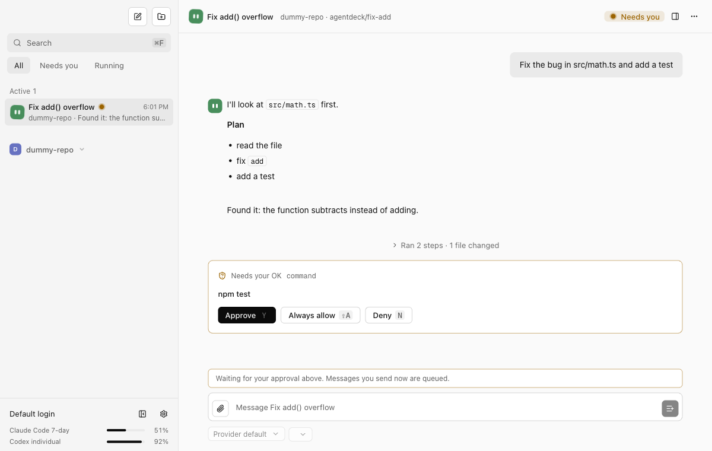
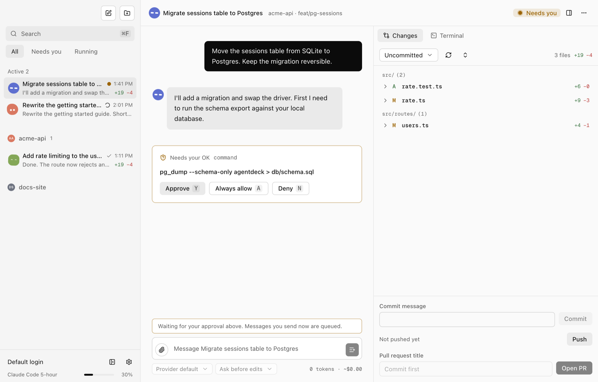
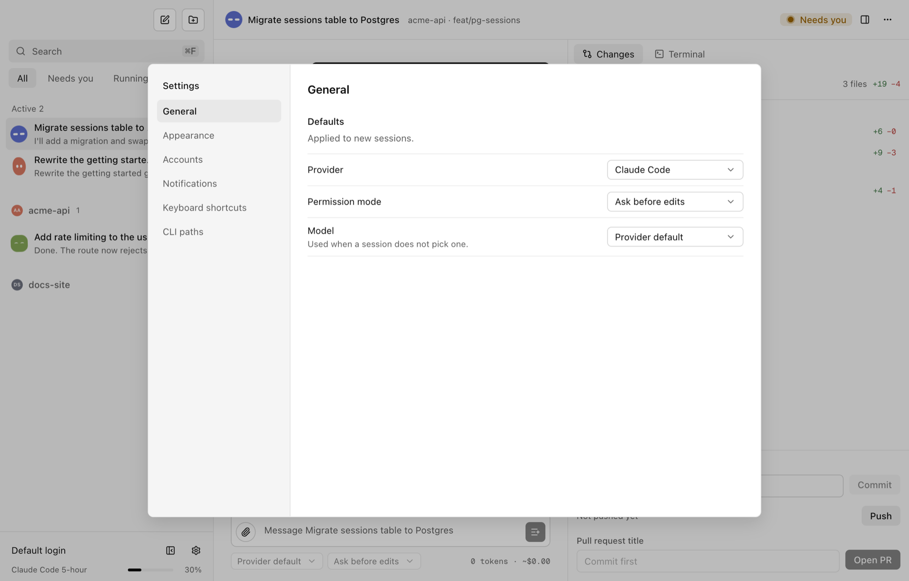

# AgentDeck

AgentDeck is a macOS desktop app for running several AI coding agents (Claude Code and Codex) side by side. Each session works in its own git worktree, so agents never overwrite each other's files or your checked-out branch.

Instead of juggling terminal tabs, you get one sidebar of every session across your projects, with a status dot that shows which agent is working, done, or waiting for you. When an agent wants to run a command or edit a file, you approve or deny it in the app, review its changes as a diff, and commit, push and open a pull request without leaving the window. Agents use your own Claude and Codex CLI logins, and all data stays on your machine.



## Features
- Projects and sessions: add a local git repo, start chat sessions, resume after restart.
- Worktree per session, plus `agentdeck.json` setup scripts.
- Terminal tab in the session's worktree.
- Approve or deny edits and commands; Ask before edits, Auto-edit, Full access and Plan only modes. With a request focused, `Y` approves and `N` denies.
- Changes panel: per-file diff grouped by folder, revert a file, then commit, push and open a PR (`gh pr create`) from one form.
- Sidebar grouped by project, filterable by Needs you / Running, with transcript search (`⌘F`). Drag its edge to resize (240–400px) or collapse it to a rail (`⌘B`).
- `⌘K` command palette, `⌘N` new session, `⌘J` next session that needs you. Full list in Settings, Keyboard shortcuts.
- Settings: defaults, accounts, notifications and light/dark/system theme.
- Fork, rename, archive and rewind files to a checkpoint.
- Status dots, dock badge and notifications.
- Multiple Claude/Codex logins, moving a session between accounts, usage and plan limits.

### Screenshots
Approving a command while the agent waits:



Settings:



*Screenshots use demo data.*

## Requirements
macOS, Node 24, pnpm, and the `claude` and `codex` CLIs installed and logged in. `gh` is needed for pull requests.

## Develop
```sh
pnpm install
pnpm dev          # run the app
pnpm typecheck
npx vitest run    # tests
npx knip          # unused files and exports
pnpm build:mac    # unsigned .dmg in dist/
```

## Release
Push a tag (`git tag v1.0.1 && git push --tags`). The Release workflow builds the unsigned `.dmg` and attaches it to a GitHub release.

## agentdeck.json
Put this in a repo root to prepare each new worktree:
```json
{ "copy": [".env"], "setup": "pnpm install" }
```

## Limitations
- Worktrees isolate files and branches, not ports, databases or Docker names.
- Usage and cost figures are estimates. Plan-limit data depends on what each provider exposes.
- Full-access mode lets agents run any command on your Mac. It is not a sandbox.
- Agents only run while the app is open.
- You install each CLI yourself and log in with your own subscription.
- Unsigned builds trigger a macOS Gatekeeper warning (right-click, Open).

## License
MIT
